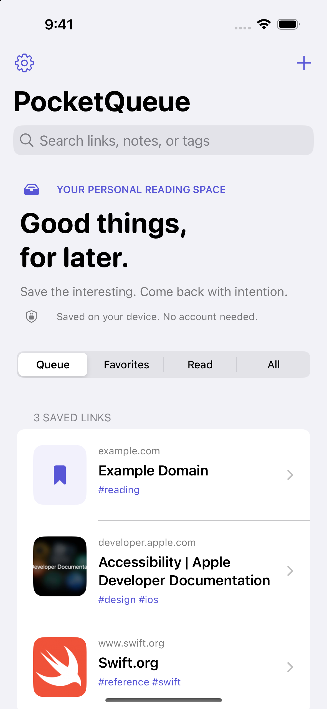
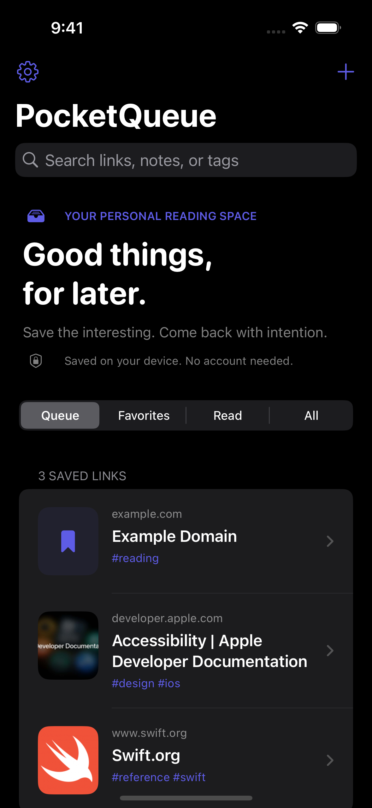

# PocketQueue

[](https://github.com/avinashrajavarapugit/PocketQueue/actions/workflows/ci.yml)

**Good things, for later.** A native, local-first iOS reading queue for links worth revisiting.

Save articles, videos, documentation, and references. Add a note about why they matter.
Come back when you have time. No account, analytics, or backend required.

<p>
  
  
</p>

Screenshots show public sample links. A fresh installation starts with an empty library.

## The important detail

**Saving a link does not depend on the website responding.**

PocketQueue commits the URL, notes, and tags to a local SQLite transaction first. It fetches optional title
and image metadata afterward. A timeout, unsupported website, or app interruption cannot undo a completed save.

## Features

- SwiftUI library with queue, favorites, read, and all filters.
- Local search across titles, URLs, tags, and notes.
- Add, edit notes/tags, favorite, mark read/unread, share, and delete with confirmation.
- Share extension: save a link from Safari without a network request.
- Read next widget with a deep link into the corresponding bookmark.
- Best-effort HTTPS previews, bounded responses, cancellation, and explicit retry.
- Offline URLs, titles, tags, and notes. **Not an offline full-article downloader.**
- Downsampled optional thumbnails with bounded memory/network usage.
- A standalone build for free personal-device signing, without App Groups or extensions.
- Swift 6 concurrency checking, an independently testable Swift package, and simulator CI.

## Run it

Requirements: a Mac, Xcode 16 or newer (Swift 6), and an iOS 17+ simulator/device.
The checked-in Xcode project can be opened without installing XcodeGen.

```sh
git clone https://github.com/avinashrajavarapugit/PocketQueue.git
cd PocketQueue
open PocketQueue.xcodeproj
```

### Simulator: complete app

Choose **PocketQueue**, select an iPhone simulator, and run. The app embeds the share and widget extensions.
No Apple Developer membership or backend credentials are needed.

### Your iPhone: free standalone build

1. Select **PocketQueueLocal**.
2. In Signing & Capabilities, select your Personal Team.
3. If necessary, change that target's bundle identifier to a unique identifier.
4. Connect your iPhone, enable Developer Mode if prompted, and run.

This variant intentionally uses its own app container and excludes extensions. It does not silently fall back
from broken shared storage. Free Personal Team provisioning expires periodically (normally seven days).

### Your iPhone: share extension + widget

Use the **PocketQueue** scheme with a team supporting App Groups:

1. Set unique bundle identifiers for the app, share extension, and widget.
2. Register one App Group and set `APP_GROUP_IDENTIFIER` consistently for all three targets.
3. Select your development team for all three targets.
4. Run on your device. In Safari's Share sheet, choose **PocketQueue** (or **Save to PocketQueue**), under More if needed.
5. Add the **Read next** widget from the Home Screen widget gallery.

Prefer editing [project.yml](project.yml) and regenerating rather than maintaining divergent project settings.
App Store/TestFlight distribution normally requires paid Apple Developer Program membership.
This repository is not an App Store deployment.

## Build and test

```sh
# Fast domain, storage, metadata networking, and state tests, with no simulator:
xcrun swift test --parallel

# If changing project configuration:
brew install xcodegen swiftlint
xcodegen generate
swiftlint lint --strict

# Discover a destination instead of assuming a simulator model:
xcrun simctl list devices available
xcodebuild test \
  -project PocketQueue.xcodeproj \
  -scheme PocketQueue \
  -destination 'platform=iOS Simulator,id=YOUR_SIMULATOR_UDID' \
  -derivedDataPath build/DerivedData \
  -resultBundlePath build/TestResults.xcresult \
  -parallel-testing-enabled NO \
  CODE_SIGN_IDENTITY=-
```

Ad-hoc simulator signing (`-`) needs no paid account and preserves the App Group entitlements.
Do not disable signing for the full app's cross-process tests: unsigned simulator builds cannot reliably access App Groups.

If a custom XcodeGen installation reports missing base settings, use a complete official installation
(for example, Homebrew's `xcodegen`). The generator requires its bundled settings presets.

### What the tests cover

- URL validation and canonicalization without dropping meaningful queries/fragments.
- Durable saves across independently opened connections.
- Concurrent writers and duplicate-save idempotency.
- Metadata updates preserving notes and never resurrecting deleted bookmarks.
- Invalid/future database schemas failing explicitly instead of resetting user data.
- HTTP errors, MIME validation, response limits, and cancellation.
- Save-before-fetch, retry, filters, search, duplicates, and storage failure UI state.
- Automated UI flows for save, read/favorite, relaunch, search, failed preview, editing, validation, and deletion.
- A real share-sheet integration test that saves in the extension and verifies the main app's shared library.
- Cold-launch widget deep-link navigation and accessibility-size text layouts.
- Actual Home Screen widget installation, rendered bookmark content, and tap-through after terminating the app.
- Bounded recovery from simultaneous first-open SQLite journal initialization.

Network tests use `URLProtocol` fixtures. UI tests use an isolated database and explicitly injected fake metadata.
Normal app launches use the real website-preview client. Test hooks are excluded from Release builds.

## Architecture and interview walkthrough

See [Architecture](docs/ARCHITECTURE.md) for boundaries, tradeoffs, failure behavior, and future sync decisions.
See [Validation](docs/VALIDATION.md) for reproducible checks and the manual extension/widget checklist.
See [Privacy](docs/PRIVACY.md) for data handling.

```text
SwiftUI views -> @MainActor LibraryModel -> BookmarkStoring
                                          |
                                          v
                                    SQLite actor
                                          ^
                                          |
Share extension -------------------------+
Widget ---------------------------------+

LibraryModel -> MetadataFetching -> URLSession -> saved website
```

There are no third-party runtime dependencies. The app, share extension, and widget use the same local Swift package.

## Deliberate limits

- No login, cloud sync, GraphQL, AI summarization, arbitrary HTML rendering, or full-text article extraction.
- Preview extraction is best effort for bounded UTF-8 HTML with title/Open Graph metadata.
- Website and image requests reveal your IP address to their servers.
- Cached thumbnails may be evicted; offline metadata/notes do not depend on those images.
- Widgets are scheduled by iOS, not guaranteed to refresh immediately.
- The library targets personal collections, not a million-item database. Current filtering decodes the small collection.
- No claim of production scale, real-user monitoring, or completed App Store release.

## Contributing

Use a small branch and a focused pull request. Explain the behavior change and tradeoffs; add tests for regressions.
CI lints, runs the package tests, builds/tests the app and extensions, and builds the standalone variant.
Keep screenshots/test artifacts free of personal URLs and credentials.

AI assisted initial implementation. The repository includes executable validation rather than treating generated code as proof
of correctness. Further changes should undergo the same review and testing.

## License

[MIT](LICENSE)
